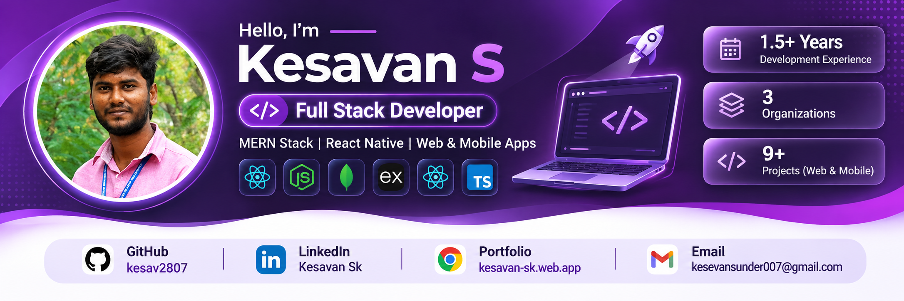

  

 

# Kesavan S

### Full Stack Developer | MERN Stack | React Native

**1.5+ Years of Development Experience | Building Modern Web & Mobile Applications**

---

## Professional Overview

| Experience | Organizations | Featured Projects |
|:---:|:---:|:---:|
| **1.5+ Years** | **3** | **9+** |
| Development Experience | Professional Experience | Web & Mobile Applications |

## About Me

I am a Full Stack Developer with 1.5+ years of development experience, specializing in MERN stack technologies and React Native application development.

I enjoy building modern, scalable and user-friendly web applications, mobile applications, admin dashboards, business management systems and AI-powered digital solutions.

My experience covers frontend development, backend API integration, database management, authentication, responsive UI/UX design, testing and deployment.

- **Experience:** 1.5+ Years
- **Current Role:** Junior Developer
- **Primary Stack:** React.js, React Native, Node.js, Express.js, MongoDB
- **Frontend:** HTML, CSS, JavaScript, TypeScript, Tailwind CSS
- **Backend:** Node.js, Express.js, REST APIs
- **Database:** MongoDB, MySQL, Firebase
- **Interests:** Full Stack Development, UI/UX, Mobile Applications, AI Integration
- **Location:** Madurai, Tamil Nadu, India

---

## Professional Experience

### Junior Developer — Smart Digital Service
**January 2026 – Present**

- Develop and maintain modern web and mobile applications.
- Build frontend interfaces using React.js and React Native.
- Develop backend services and REST APIs using Node.js and Express.js.
- Work on advertisement management and billing applications.
- Implement automated PDF and PowerPoint reporting workflows.
- Integrate authentication, validation and database operations.
- Perform end-to-end application testing using Cypress.
- Improve application performance and responsive UI experiences.

**Key Achievements**
- Delivered two live enterprise applications.
- Reduced invoice processing time by 40%.
- Improved advertisement engagement by 25%.

### Software Developer Trainee Intern — Spangles Infotech
**May 2025 – December 2025**

- Converted Figma designs into React Native application screens.
- Developed reusable mobile components and application navigation.
- Built a Textile Admin Dashboard and E-Commerce platform.
- Implemented role-based access control.
- Worked with React.js, React Native, Node.js, Express.js and MongoDB.
- Improved responsive layouts and frontend performance.

**Key Achievements**
- Improved inventory-tracking efficiency by 30%.
- Delivered pixel-focused UI implementation across application screens.

### Software Developer — Offer360 Technologies
**Dates not specified**

- Worked on the E-Gold digital gold investment platform.
- Developed AR virtual try-on features using MediaPipe and React Webcam.
- Implemented interface animations using Framer Motion.
- Added multilingual support using react-i18next.
- Improved frontend experience and interactive application features.

**Key Achievement**
- Contributed to a 35% improvement in platform engagement.

---

## Technical Skills

### Frontend Development

### Mobile Development

### Backend Development

### Database & Cloud

### Tools & Technologies

### AI & Development Tools

- OpenAI API
- ChatGPT
- GitHub Copilot
- Cursor AI
- Google Stitch
- Figma AI

---

## Featured Projects

### 01. Hotel IPTV & Digital Guest Experience Platform

**Technologies:** React.js, LG webOS, Node.js, Express.js, MongoDB, HLS, Tailwind CSS

A hospitality platform connecting in-room Smart TV experiences, guest services and hotel operations.

- Smart TV client with remote-control navigation.
- Live TV and HLS video playback.
- QR-based guest food ordering.
- Housekeeping and room-service requests.
- Hotel operations dashboard and content management.
- Role-based access for Super Admin, Distributor and Hotel Admin.

### 02. E-Gold — Digital Gold & AR Experience

**Technologies:** React.js, MediaPipe, React Webcam, Framer Motion, react-i18next

- Digital gold investment experience.
- Camera-based AR virtual try-on.
- Computer-vision integration using MediaPipe.
- Animated interactions.
- Multilingual application support.

### 03. EGA ADS / EGS ADS — Advertisement Work Management

**Technologies:** React Native, Node.js, Express.js, MongoDB, Google Maps API

- Advertisement workforce and field-operations management.
- GPS tracking, route monitoring and geofencing.
- Role-based dashboards.
- Media upload and verification workflows.
- Automated PDF and PowerPoint reporting.

### 04. eBankix — Digital Banking Mobile Application

**Technologies:** React Native, Expo, JavaScript, Figma, React Navigation

- Mobile banking interface developed from Figma designs.
- User onboarding and authentication screens.
- Transaction history and profile management.
- Reusable components and mobile navigation.
- Android and iOS support.

### 05. Textile Admin Dashboard & E-Commerce Platform

**Technologies:** React.js, Node.js, Express.js, MongoDB, Tailwind CSS

- Textile product and inventory management.
- Stock monitoring and sales analytics.
- Admin dashboard and user management.
- Role-based access control.
- Responsive product-management interface.

### 06. Billing & Invoice Management System

**Technologies:** React.js, Node.js, Express.js, MongoDB, PDFKit, jsPDF

- Product search and itemized billing.
- GST and discount calculations.
- Invoice and receipt generation.
- Barcode and QR scanner input.
- Sales and inventory workflows.

### 07. Trek N Stay — Travel & Accommodation Platform

**Technologies:** React.js, Node.js, Express.js, MongoDB, Google Maps API

- Property and accommodation discovery.
- Location-based search with Google Maps.
- Booking and enquiry workflows.
- Responsive web experience.

### 08. Rajaraja Cholan — AI Voice Agent

**Technologies:** React.js, Node.js, Express.js, OpenAI API, MongoDB Atlas, RAG

- Historical knowledge sourced from reference PDFs.
- Retrieval-Augmented Generation workflow.
- MongoDB Atlas vector search.
- Voice input and AI-generated responses.
- Historical persona-based conversation experience.

### 09. Q Crackers — E-Commerce & Billing Platform

**Technologies:** React.js, Node.js, Express.js, MongoDB

- Customer-facing product website.
- WhatsApp-based ordering workflow.
- Retail billing application.
- Admin, inventory and sales management.
- Barcode and QR code generation.

---

## Education

### Master of Computer Applications (MCA)

**RVS College of Arts and Science**  
Bharathiar University | 2023 – 2025  
**CGPA: 8.30 / 10**

### Bachelor of Commerce (B.Com)

**N.M.S.S. Vellaichamy Nadar College**  
Madurai Kamaraj University | 2020 – 2023  
**CGPA: 5.90 / 10**

---

## GitHub Statistics

---

## Contribution Activity

---

## Connect With Me

### Building useful products through thoughtful engineering.

